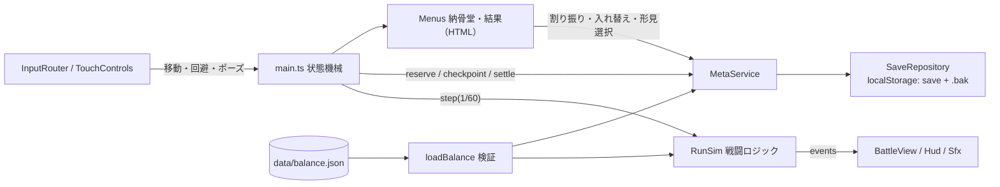
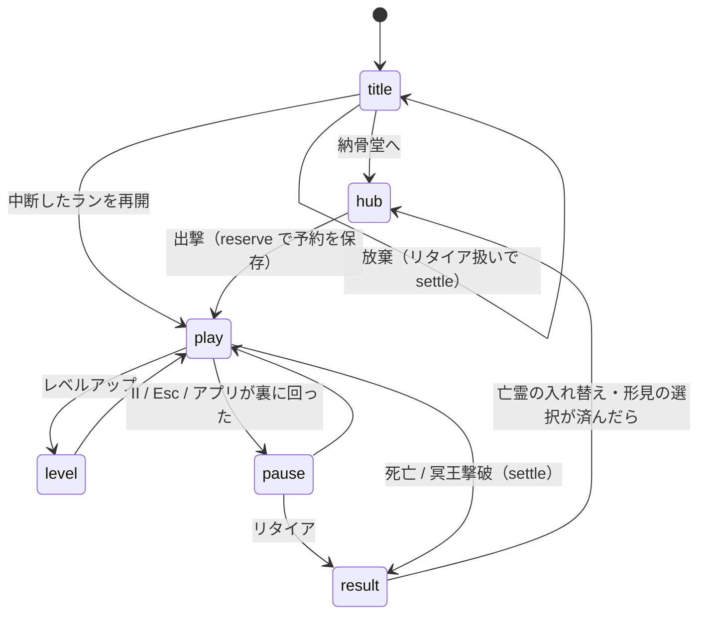

# アーキテクチャ（縦切りスライス＋フェーズ1 / TypeScript 版）

## 状態遷移

## ループ
- `requestAnimationFrame` ごとに経過時間をためて、1/60秒ずつ `RunSim.step()` を回す（1フレーム最大4回。遅い端末では「ゆっくり」になり、追いつこうとして重くなる悪循環を防ぐ）。
- 描画はキャンバス1枚（戦場＋HUD＋タッチ操作）。画面の細かさは最大2倍。メニューは HTML をキャンバスの上に重ねる。

## 分け方のルール
- `src/sim` と `src/meta` は DOM・描画・入力を使わない（Node のテストでそのまま動く）。
- 戦闘からの通知は `events`（fx / sfx / toast / shake）。表示側は状態を読むだけ。
- 乱数は `RngStreams`（spawn / cards / misc）。用途を足す時は列を足す。
- 保存先は `KV`（localStorage と同じ形）。テストはメモリ、Steam 版ではファイルに差し替える。
