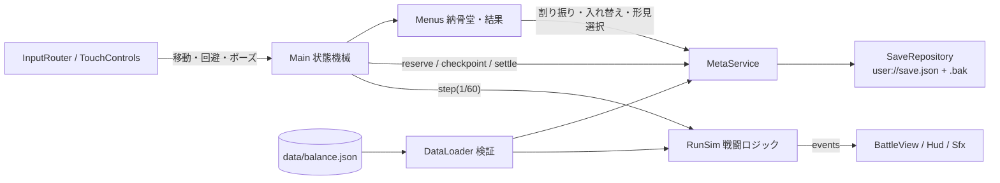
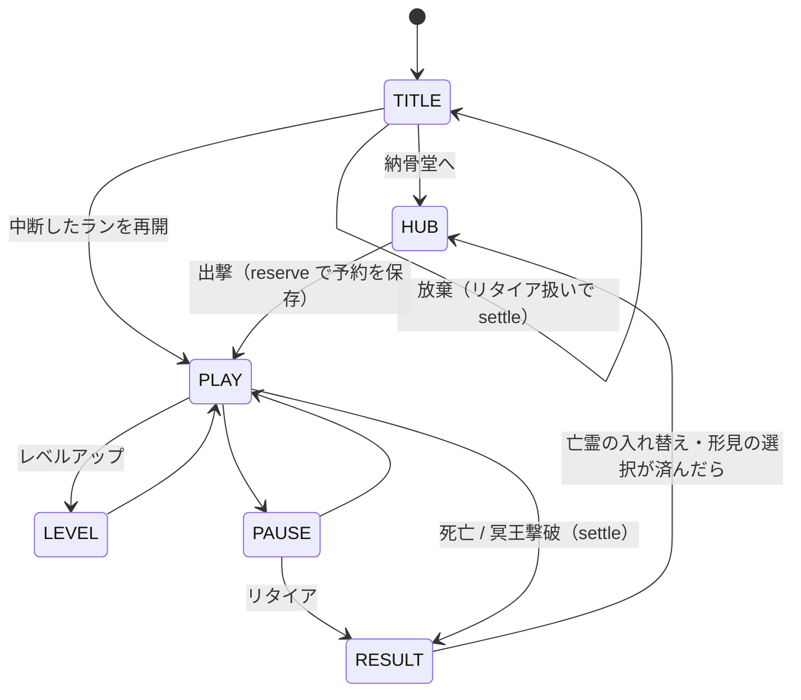
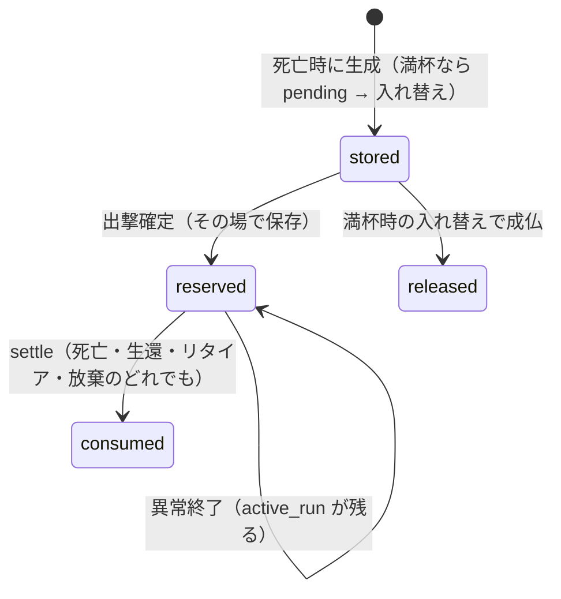

# アーキテクチャ（縦切りスライス＋フェーズ1）

## 状態遷移

## 亡霊・形見のライフサイクル

## ラン終了処理（`MetaService.settle`）の順番
1. `settled_runs` に run_id があれば何もしない（冪等）
2. 同行亡霊: reserved かつ同じ run なら consumed
3. 死亡時: 亡霊を生成（満杯なら pending）
4. 供物・世代数・累計生存時間を加算、使った形見を棚から外す、形見の候補を pending に
5. 履歴・処理済み記録・`active_run = null` を**1回の書き込み**で確定

## 性能
- 敵は `RefCounted` の軽量オブジェクト、近傍探索は `SpatialGrid`、描画は `BattleView._draw()` で一括
- 計測: テスト `t10_load_300`（敵300体・3武器Lv5で約2.5ms/tick）、ゲーム内の Settings →「負荷試験」（実機のFPS）、F3 デバッグHUD
